<div align="center">

# Robot vs Robot Tic-Tac-Toe
### Two Niryo Ned2 robots play against each other (or against you) using only their wrist cameras

**Computer vision · Robot motion planning · Learned paths · Python / OpenCV**

    

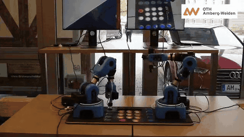

*The two robots playing each other (final test before the expo, OTH Amberg-Weiden).*

**Author: Hadi Sarhangi Fard** — AI Engineer / Mechanical Engineer
[LinkedIn](https://www.linkedin.com/in/hadi-sarhangi-fard-mech-eng/) · [GitHub](https://github.com/Hadifard) · [YouTube](https://youtube.com/@hfard)

</div>

---

## Table of contents

1. [What is this project? (60-second version)](#1-what-is-this-project-60-second-version)
2. [Start here: your first 10 minutes (no robot needed)](#2-start-here-your-first-10-minutes-no-robot-needed)
3. [The hardware and the playing board](#3-the-hardware-and-the-playing-board)
4. [Map of the repository: what every file does](#4-map-of-the-repository-what-every-file-does)
5. [How the system works (charts)](#5-how-the-system-works-charts)
6. [Which variant should I use?](#6-which-variant-should-i-use)
7. [Running with the real robots, step by step](#7-running-with-the-real-robots-step-by-step)
8. [How the code works, module by module (deep dive)](#8-how-the-code-works-module-by-module-deep-dive)
9. [Training: what is learned, how, and how to retrain](#9-training-what-is-learned-how-and-how-to-retrain)
10. [The challenges and how we solved them one by one](#10-the-challenges-and-how-we-solved-them-one-by-one)
11. [Results](#11-results)
12. [Simulation environment and how the board was built](#12-simulation-environment-and-how-the-board-was-built)
13. [Video library](#13-video-library)
14. [Troubleshooting for students](#14-troubleshooting-for-students)
15. [Ideas for your own extensions](#15-ideas-for-your-own-extensions)

---

## 1. What is this project? (60-second version)

Two **Niryo Ned2** robot arms stand at the two ends of a Tic-Tac-Toe board. Each robot has its own
program, its own wrist camera and its own coloured chips (green or blue). **They never talk to each other
over a network.** They coordinate only through what the cameras can see: a **red turn token** that
is carried from one side to the other. The same code also lets a **human** play against a robot.

Robot vs. Robot Tic-Tac-Toe is an advanced open-source robotics project powered by Niryo Ned2 6-axis arms, 
robust computer vision, and an unbeatable Alpha-Beta Minimax decision-making engine. By seamlessly bridging 
real-time visual perception, precise motion planning, and physical execution, this project transforms a 
classic game into a comprehensive, fault-tolerant engineering pipeline where machines sense, adapt, 
and never lose.   


<div align="center">
  <a href="https://github.com/Hadifard/niryo-ned2-robot-tictactoe/releases/download/v1.0.0/Final_Movie_Small.gif">
    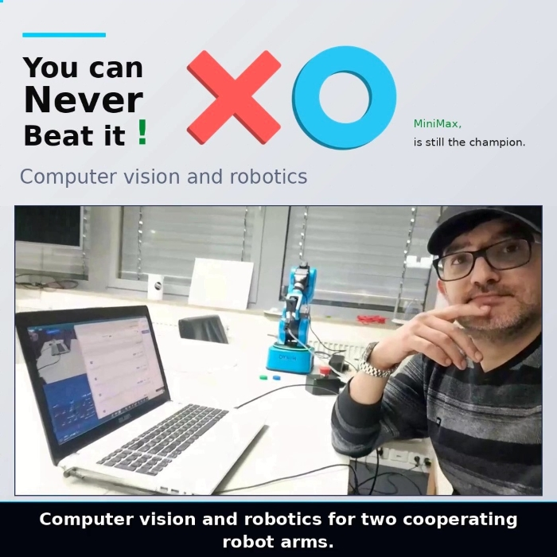
  </a>
</div>


The game rules are the easy part (a perfect alpha-beta minimax player is 40 lines). The real work was making this
survive reality:

| Real-world problem | Our answer (details in [section 10](#10-the-challenges-and-how-we-solved-them-one-by-one)) |
|---|---|
| Robot has gear backlash and a few mm of repeatability error | vertical final descent, polar arcs, per-cell correction table, vision-guided picking |
| Room light changes (day, lamps, shadows) | HSV colour model + white-patch + CLAHE, **or** background subtraction in Lab, **or** image differencing without colours |
| Paper/board is never in exactly the same place | **two coloured circles** give rotation, scale and shift in closed form |
| Cheap, noisy, distorted wrist camera | undistortion, majority vote over several frames, "unstable view" rejection |
| Deep-learning detectors too heavy for lab laptops | classical segmentation (HSV + distance transform + watershed), ~20 ms/frame on one CPU core |
| Two robots, no shared network, one board | red-token protocol + folded standby pose + verified board changes |
| No depth sensor | the chip diameter (30 mm) is the metric ruler: `Z = f·D/d` |
| Robot must not hit chips or the other arm | parabolic 3-D paths, learned lift height, lateral detour search |
| Development without risking the hardware | complete simulator (synthetic camera + mock robot + simulated human), 28 automatic tests, SolidWorks motion study |

> **For students:** you can run the *whole game* on your laptop in two minutes without any robot — see the next section.

---

## 2. Start here: your first 10 minutes (no robot needed)

```bash
# 1) get the code
git clone https://github.com/Hadifard/niryo-ned2-robot-tictactoe.git
cd niryo-ned2-robot-tictactoe/niryo_tictactoe

# 2) (recommended) a clean Python environment
python -m venv .venv
source .venv/bin/activate            # Windows:  .venv\Scripts\activate

# 3) install the libraries   (pyniryo / pyniryo2 are only needed for the real robot;
#    if they fail to install, the demo and tests still work)
pip install opencv-python numpy matplotlib pillow
pip install pyniryo pyniryo2         # optional now, required for the real robot

# 4) check everything
python main.py check                 # prints OK / MISSING for each library + 2 self-checks
python main.py selftest              # 28 automatic tests, about 20 seconds
python main.py demo                  # plays a full simulated game, saves pictures + GIF
```

`python main.py guide` prints all available commands. **Always run commands from the `niryo_tictactoe/` folder.**

### What the demo does

`python main.py demo` runs the **real** vision code, the **real** game loop and the **real** minimax agent. Only the camera,
the robot and the human are simulated. The paper is deliberately rotated and shifted, and the vision code has to
find it again by itself. Each picture below is what the robot's camera "sees" after one chip was placed; the
overlay shows the detected circles A/B, the 9 cells, the chip trays and the red token spots.

<div align="center">
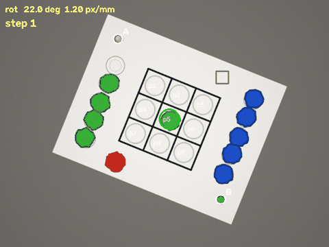
</div>


Try `python main.py demo --rot 140 --seed 5` — a different rotation and a different (random) human opponent.
Results are written to `demo_output/` (ignored by git).

### Learning path for a new student

| Step | Do this | You learn |
|---|---|---|
| 1 | `python main.py demo`, open `demo_output/*.png` | what the robot "sees" |
| 2 | Read `common/game_logic.py` (200 lines) | rules, minimax, `diff_boards` |
| 3 | Read `common/colors.py` + `v1_fixed_layout/vision_fixed.py` | colour classification |
| 4 | Read `v2_two_circle_calibration/calibration.py` | the 2-circle similarity transform |
| 5 | Read `common/game_runner.py` | the whole turn protocol in one file |
| 6 | `python main.py train-path` | how the path model is trained |
| 7 | Real robot: [section 7](#7-running-with-the-real-robots-step-by-step) | calibration and play |

---

## 3. The hardware and the playing board

| Item | Details |
|---|---|
| Robots | 2 × **Niryo Ned2**, vacuum/suction cup tool (`grasp_with_tool` / `release_with_tool`) |
| Cameras | the robots' own wrist cameras (640×480 after resize, undistorted with the robot's intrinsics) |
| Computer | an ordinary laptop (CPU only). One terminal / one program per robot |
| Chips | 30 mm discs: **green** and **blue** for the two players, **red** = turn token |
| Board | custom playing ground: 3×3 playing cells + two rows of 5 chip holes + two large openings for the robot bases |

<table>
<tr>
<td>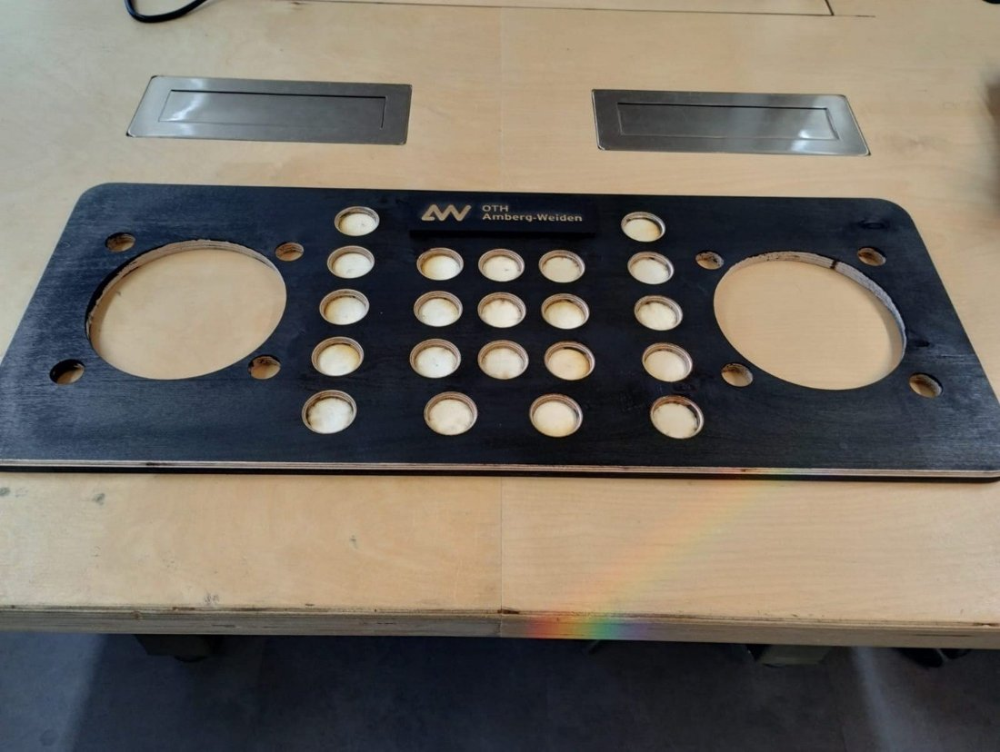<br><sub>The finished board: 3×3 cells in the centre, five chip holes on each side, two openings for the robot bases.</sub></td>
<td>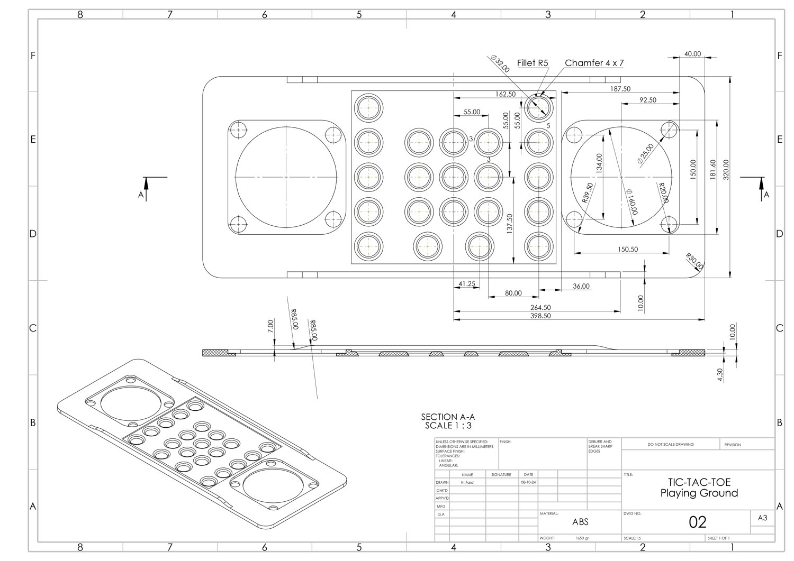<br><sub>SolidWorks drawing (A3): Ø32 mm holes with 4×7 chamfer for Ø30 mm chips, 55 mm pitch, two Ø160 mm base openings.</sub></td>
</tr>
</table>

The chamfered holes are slightly larger than the chips on purpose: a chip that is dropped a few millimetres off-centre
slides into the hole. (The seat still has about **5 mm of play**, which is why the image-difference tracker uses the largest
region and its centre of mass instead of a perfect circle fit.)

**Two setups were used in the project.** First a *paper* board on cardboard (fast to change, used for most vision work),
then the final CNC-milled board for the two-robot game:

<table>
<tr>
<td>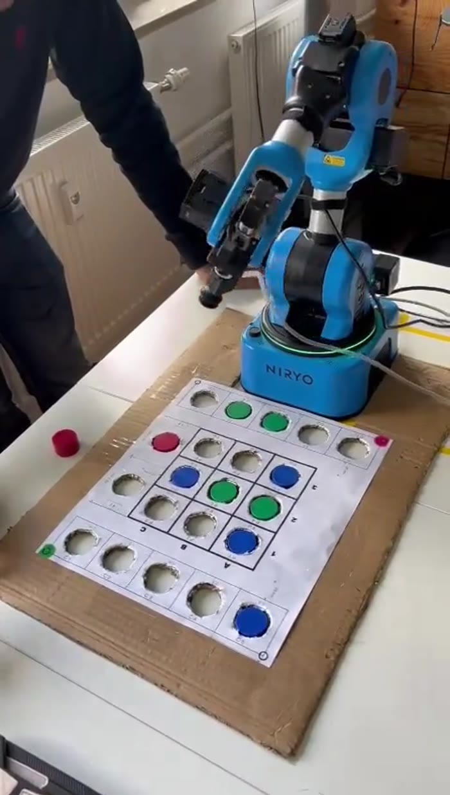<br><sub>Paper board on cardboard: robot against a human.</sub></td>
<td>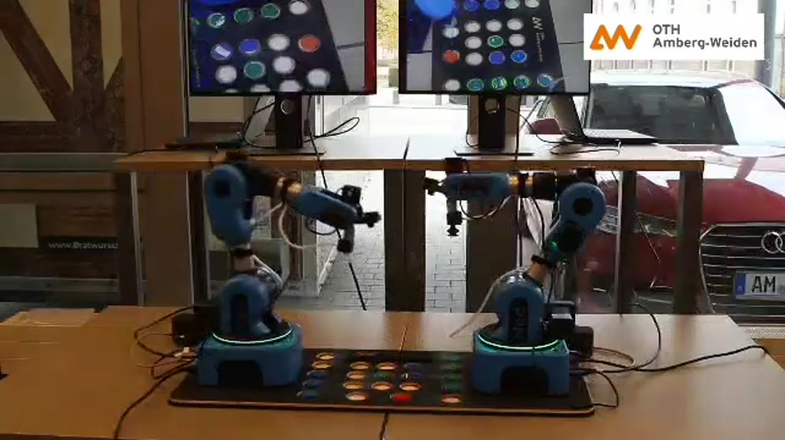<br><sub>Final board: robot against robot (expo).</sub></td>
<td>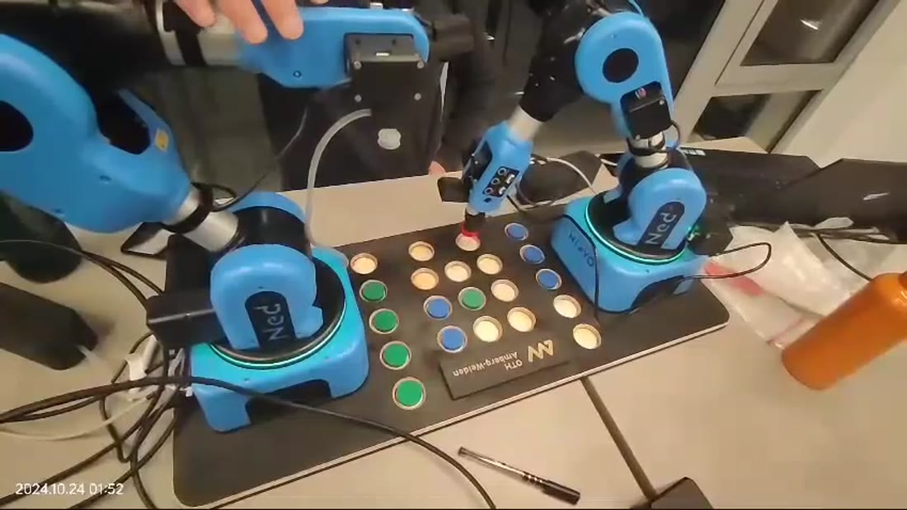<br><sub>Close-up in the lab.</sub></td>
</tr>
</table>

---

## 4. Map of the repository: what every file does

```
niryo-ned2-robot-tictactoe/
├── README.md                      <- you are here
├── requirements.txt               <- pip install -r requirements.txt
├── docs/
│   ├── images/                    <- figures (fig_*.png), real photos (real/), film frames (film/)
│   ├── media/                     <- GIFs used in this README
│   └── results/                   <- raw numbers behind every chart (JSON)
├── video_production/              <- (optional) code that rendered the 216-second explainer film
└── niryo_tictactoe/               <- ★ THE MAIN CODE: work here
    ├── main.py                    <- ★ one entry point for everything:  python main.py guide
    ├── check_setup.py             <- checks Python, libraries, (robot network)
    ├── demo_simulation.py         <- full game without robot, saves pictures + GIF
    ├── requirements.txt
    ├── common/                    <- shared by all three vision variants
    │   ├── game_logic.py          <- rules, alpha-beta minimax, random & hybrid agents, diff_boards
    │   ├── game_runner.py         <- the turn protocol / game loop (the "brain")
    │   ├── robot_control.py       <- pick & place with backlash tricks, poses, MockRobot
    │   ├── trajectory.py          <- polar-space arcs (r, theta) with parabolic height
    │   ├── colors.py              <- HSV ranges, white-patch, CLAHE, disc vote classifier
    │   ├── camera.py              <- NiryoCamera, VideoCamera (replay), ImageCamera (tests)
    │   ├── depth.py               <- Z = f·D/d, learned depth model, safety monitor
    │   └── path_learning.py       <- trial-and-error + ridge regression for path lift, detours
    ├── v1_fixed_layout/           <- variant 1: everything at fixed positions
    │   ├── config_fixed.py        <- pixel table + robot coordinates (edit when you move things)
    │   ├── vision_fixed.py        <- reads 9 cells + token at fixed pixels
    │   ├── recorded_positions.py  <- hand-taught poses for dark rooms
    │   └── play_fixed.py          <- run this to play (variant 1)
    ├── v2_two_circle_calibration/ <- variant 2: paper anywhere, found by two circles
    │   ├── calibration.py         <- Similarity2D (complex numbers), BoardLayout, HandEye
    │   ├── vision_calibrated.py   <- vision relative to the two circles
    │   └── play_calibrated.py     <- run this to play (variant 2)
    ├── v3_robust_background_subtraction/  <- variant 3: robust to light and shadows
    │   ├── vision_robust.py       <- rectified top view + Lab background subtraction
    │   ├── diff_tracker.py        <- colour-free tracking by image differencing (2 fps)
    │   └── play_robust.py         <- run this to play (variant 3)
    ├── segmentation/
    │   ├── classical_segmentation.py  <- one mask per chip: HSV + distance transform + watershed
    │   └── yolo_seg_demo.py           <- the heavy deep-learning comparison (YOLOv8-seg)
    ├── tools/                     <- one-time helpers for the real robot
    │   ├── click_cells.py         <- v1: click the 9 cells -> pixel table
    │   ├── calibrate_hand_eye.py  <- v2/v3: pixel -> robot XY in one minute
    │   ├── record_corrections.py  <- optional per-cell backlash correction table
    │   └── train_path_model.py    <- train and save the learned-path model
    ├── analysis/                  <- scripts that produced the charts in this README
    │   ├── sim_figures.py, vision_benchmark.py, style.py
    └── tests/
        ├── test_all.py            <- 28 automatic tests, no robot needed
        └── synth.py               <- synthetic camera + simulated world used by tests and demo
```

Every Python file starts with the same header: **file name, description, author, LinkedIn.**

---

## 5. How the system works (charts)

### 5.1 Architecture: what talks to what

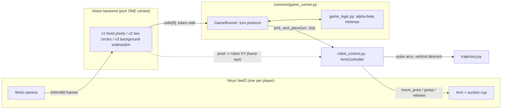

### 5.2 The turn protocol: how two robots play with no network link

A red token lies on spot **A** or **B**. The robot whose side holds the token must play.
After placing its chip, a robot carries the token to the opponent's spot. The opponent's camera sees it and wakes up.

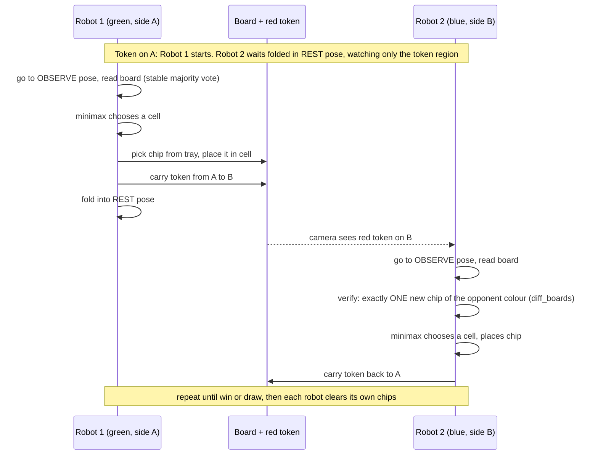

### 5.3 One robot's state machine (`GameRunner`)

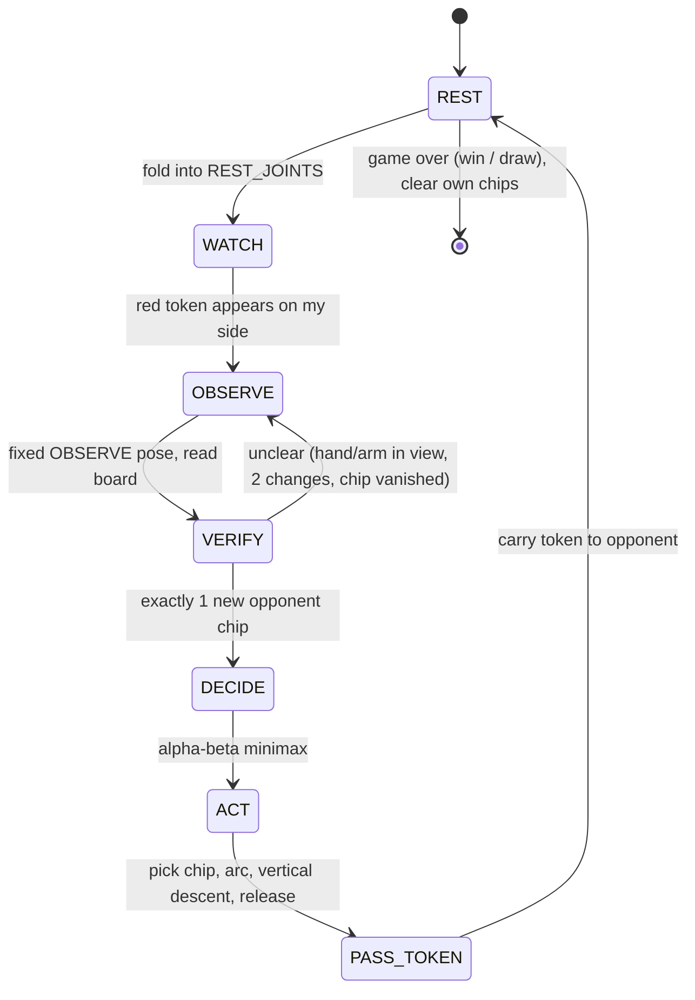

### 5.4 Calibration workflow

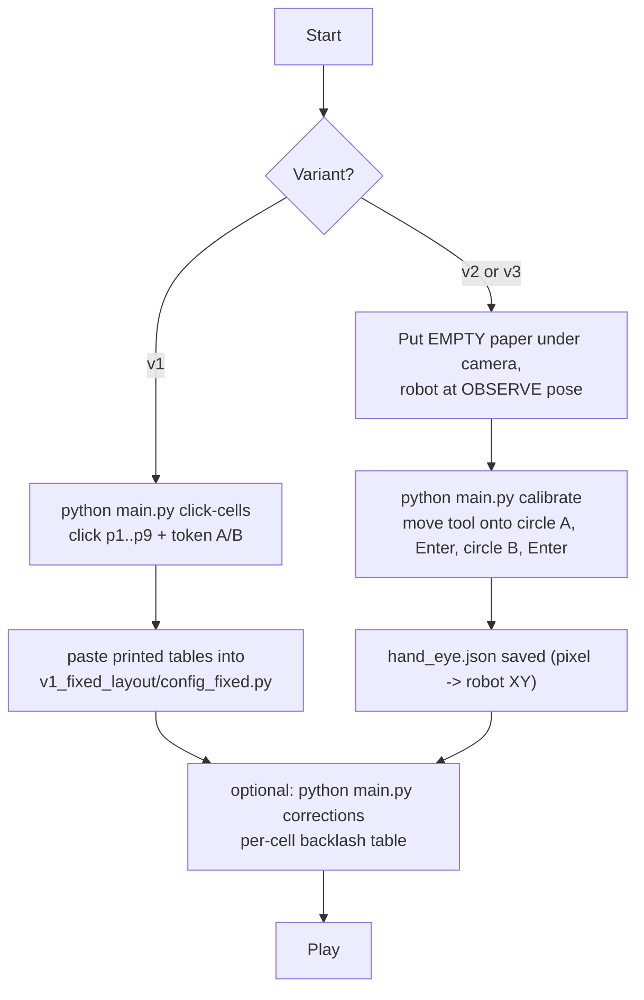

---

## 6. Which variant should I use?

The three variants share the **same game loop**. They only differ in how they find the board.

| | Variant 1 | Variant 2 | Variant 3 |
|---|---|---|---|
| Folder | `v1_fixed_layout/` | `v2_two_circle_calibration/` | `v3_robust_background_subtraction/` |
| Idea | everything at fixed pixels / fixed robot coordinates | two coloured circles locate the paper (rotation + scale + shift) | variant 2 + rectified top view + Lab background subtraction |
| Calibration | measure pixel table once (`click-cells`) | one-minute hand-eye (`calibrate`) | one-minute hand-eye + empty-board reference at start |
| Paper rotated / moved? | **No** (accuracy collapses, see [results](#11-results)) | **Yes**, any rotation and position | **Yes** |
| Light changes / shadows | colour normalisation only | colour normalisation | **best**: gain matching + chroma-weighted subtraction |
| Speed (this CPU) | 11.7 ms/frame | 13.5 ms/frame | 47 ms/frame |
| Start condition | none | none | **empty board** (learns the background) |
| Pick it when… | setup never moves; simplest | paper may move; normal light | strongly changing light, shadows, reflections |

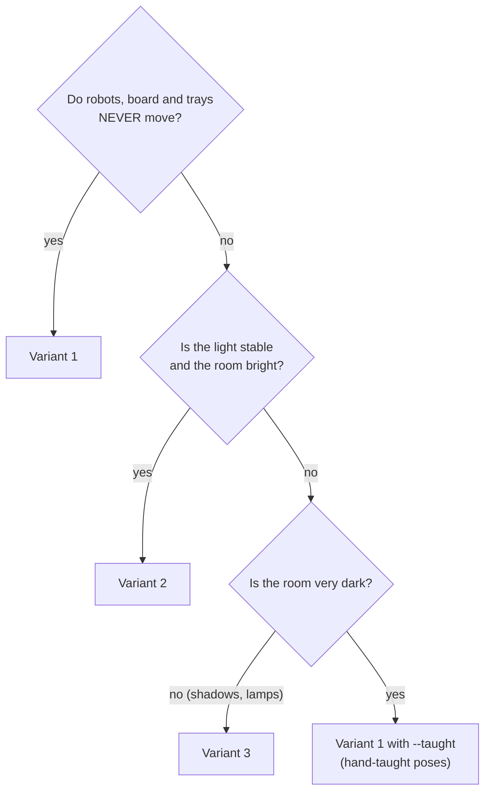

---

## 7. Running with the real robots, step by step

### 7.1 Before you start (checklist)

- [ ] Both Niryo Ned2 robots powered on and calibrated; each reachable by its own IP (`python main.py check --ip <IP>`)
- [ ] The board between the robots; chips in the trays: **c1–c5** belong to side **A**, **c6–c10** to side **B**
- [ ] The **red token** on the spot of the robot that starts (spot **A**)
- [ ] Variants 2 and 3: the **paper with the pink circle A and the green circle B** is under the camera
- [ ] Variant 3 only: **the board is EMPTY** when the program starts (it learns the empty-board reference first)
- [ ] The laptop has `pyniryo` and `pyniryo2` installed

### 7.2 One-time calibration

```bash
# Variant 1 only: click the centres of p1..p9 and the two token spots, paste output into config_fixed.py
python main.py click-cells --ip 169.254.200.200

# Variants 2 / 3: one-minute hand-eye calibration.
# The script finds the two circles in the image, switches learning mode on, and asks you to move the
# tool tip by hand onto circle A, press Enter, then onto circle B, press Enter  ->  hand_eye.json
python main.py calibrate --ip 169.254.200.200

# Optional (all variants): per-cell correction table for backlash/systematic error -> corrections.json
python main.py corrections --ip 169.254.200.200
```

### 7.3 Play: robot against robot

Open **two terminals** (or two laptops), one per robot, each with its own `--ip`:

```bash
# Terminal 1: robot 1, green chips, token spot A, plays FIRST
python main.py play --variant 2 --ip <IP_ROBOT_1> --me green --opp blue --side A --start

# Terminal 2: robot 2, blue chips, token spot B, waits for the token
python main.py play --variant 2 --ip <IP_ROBOT_2> --me blue --opp green --side B
```

Replace `--variant 2` by `1` or `3`. Agents: `--agent minimax` (perfect, default), `random`, or `hybrid`
(2 smart moves, then random — beatable on purpose, nice for demonstrations with a human).

### 7.4 Play: human against robot

Run only the robot's command (with `--start` if the robot moves first). **The human plays the other colour,
and after each move carries the red token back onto the robot's spot** — that is the signal "I am done".

### 7.5 Dark room?

`python main.py play --variant 1 --taught ...` drives the robot with hand-taught poses from
`v1_fixed_layout/recorded_positions.py` (recorded with `robot.arm.get_pose()` in learning mode). Vision is then only used to read the board.

### 7.6 Constants students may need to adjust

| What | Where | Default |
|---|---|---|
| Robot IP | `--ip`, `config_fixed.ROBOT_IP` | `169.254.200.200` |
| Pixel table of the 9 cells / token spots (v1) | `v1_fixed_layout/config_fixed.py` | measured on our setup |
| Paper layout in mm (circles, grid, trays, token spots) (v2/v3) | `BoardLayout` in `v2_.../calibration.py`, or `--layout file.json` | the printed paper of this project |
| Suction heights | `robot_control.py`: `PICK_Z`, `PLACE_Z`, `HOVER` | 0.050 / 0.060 / 0.030 m |
| Arc height | `ARC_LIFT` | 0.05 m |
| Observation pose / standby pose | `OBSERVE_POSE`, `REST_JOINTS` | see file |
| Colour ranges | `common/colors.py` → `HSV_RANGES` | measured on our chips |

`--layout` file example (all numbers in **millimetres on the paper**, origin = pink circle A, x right, y down):

```json
{"circle_a": [0, 0], "circle_b": [252, 180], "circle_diameter": 14, "chip_diameter": 30,
 "grid_center": [126, 90], "pitch": 42,
 "token_spots": {"A": [70, 185], "B": [180, -5]}}
```

---

## 8. How the code works, module by module (deep dive)

### 8.1 Colour vision (`common/colors.py`, variant 1 and base of 2/3)

<table><tr>
<td width="55%">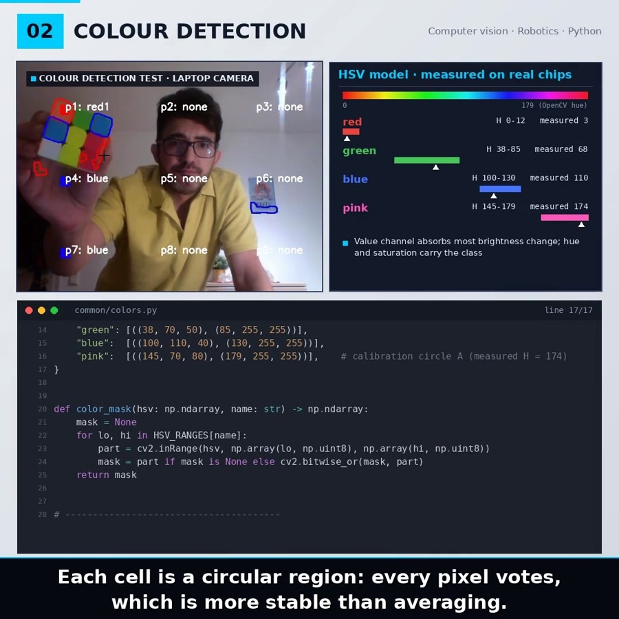</td>
<td>
<b>Why HSV?</b> In HSV, brightness (V) is separated from colour (H) and saturation (S), so a dimmer lamp changes V but barely changes H.<br><br>
<b>Measured on the real chips</b> (OpenCV scale H = 0..179): red H = 2–4, green 68, blue 110, pink calibration circle 174.<br><br>
<b>Disc vote:</b> every pixel inside a circular region votes for a colour; the colour with the largest fraction (≥ 35 %) wins. This is much more stable than the mean HSV of a square patch (the mean of two hues is a third, wrong hue).
</td></tr></table>

Pipeline per frame (`preprocess`): Gaussian blur → **white-patch** (scale each channel so the brightest 3 % — the white paper — becomes 235) → **CLAHE** on the L channel only → BGR→HSV → `classify_disc` for each cell.

| Colour | OpenCV HSV range (low → high) |
|---|---|
| red (token) | (0, 110, 60) → (12, 255, 255) |
| green | (38, 70, 50) → (85, 255, 255) |
| blue | (100, 110, 40) → (130, 255, 255) |
| pink (circle A) | (145, 70, 80) → (179, 255, 255) |

Variant 1 (`vision_fixed.py`) classifies 9 + 2 discs at fixed pixels and does a **majority vote over 7 frames**; if fewer than 70 % of the frames agree for any cell, it returns `None` ("view unstable": an arm or hand is in front of the camera) and the game loop simply waits.

<table><tr>
<td>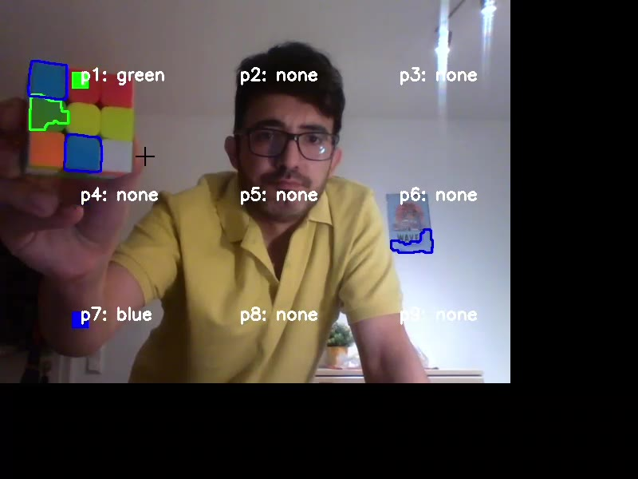<br><sub>Early colour-detection test on a laptop camera (a Rubik's cube provides red, green and blue patches).</sub></td>
<td>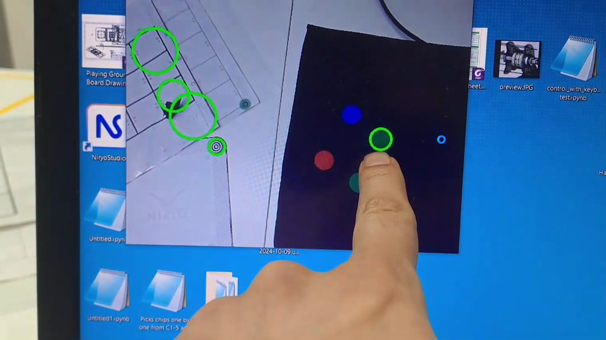<br><sub>Detection on the real board image: green rings are detected cell regions.</sub></td>
</tr></table>

### 8.2 Finding the paper with two circles (`v2_two_circle_calibration/calibration.py`)

<table><tr>
<td width="55%">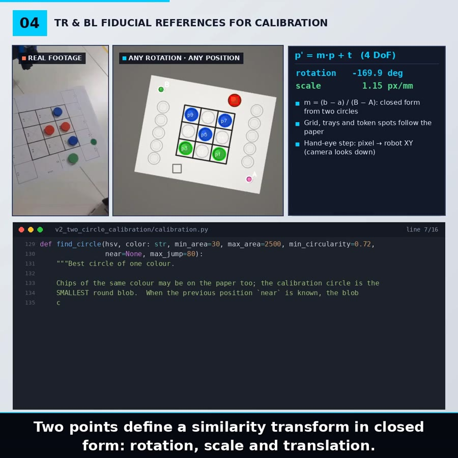</td>
<td>
A <b>pink circle A</b> and a <b>green circle B</b> are printed in two corners of the paper. Two points are exactly enough
to recover a 2-D <i>similarity transform</i> (rotation + uniform scale + translation). With complex numbers it is one line:
<pre>m = (dB − dA) / (sB − sA)
t = dA − m · sA
p' = m · p + t        |m| = scale,  arg(m) = rotation</pre>
Grid cells, chip trays and token spots are stored in <b>millimetres on the paper</b> (<code>BoardLayout</code>), so they follow
the paper wherever it lies.
</td></tr></table>

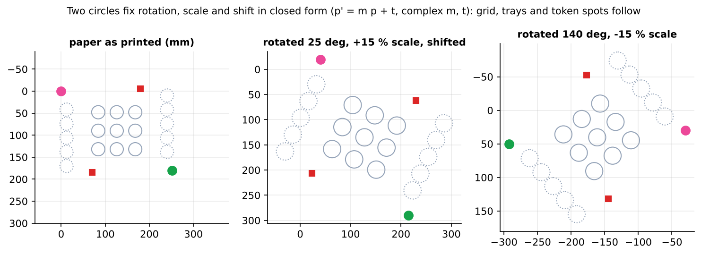

*Figure: the same layout (cells solid, trays dotted, token spots red) after three different paper poses. Pink = circle A, green = circle B.*

Circle detection (`find_circle`): HSV mask → morphological open/close → contours → keep round blobs
(circularity `4πA/P² ≥ 0.72`) → the calibration circle is the **smallest** round blob (chips of the same colour may also be on the paper).
When the previous position is known the **nearest** blob wins, so the paper can be nudged during the game and is tracked.

**Hand-eye calibration** (`HandEye`, `tools/calibrate_hand_eye.py`): the same two-point trick maps *camera pixels → robot XY (metres)*.
You touch circle A and circle B with the tool tip once; `HandEye.fit` stores a second similarity transform in `hand_eye.json`.
Valid for a camera that looks (almost) straight down, which the Ned wrist camera does at the OBSERVE pose.

**Vision-guided picking:** for each tray slot the code also refines the *real* centroid of the chip's colour blob and uses it instead of the nominal slot position (`CalibratedBackend.slot_xy`).

### 8.3 Robust vision: background subtraction in Lab (`v3_robust_background_subtraction/vision_robust.py`)

<table><tr>
<td width="55%">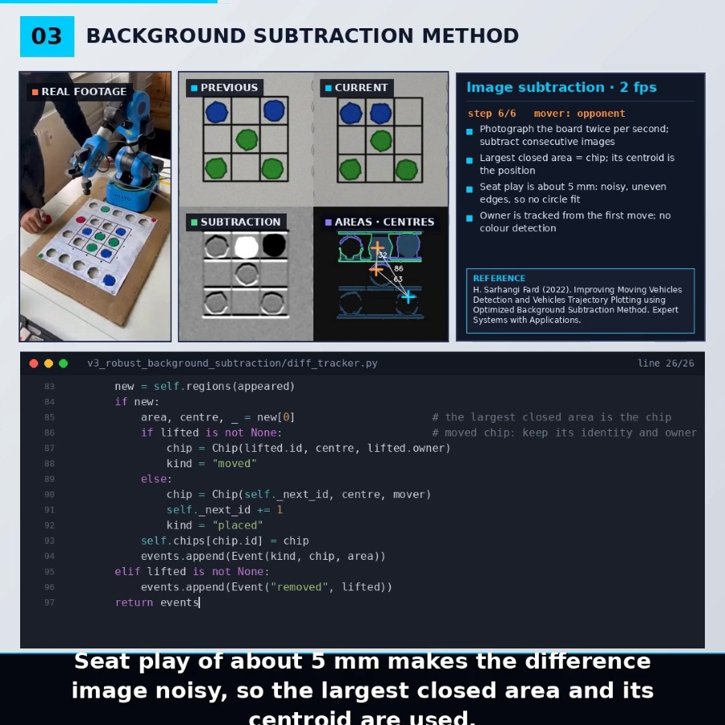</td>
<td>
<ol>
<li>Find the two circles → warp the paper to a canonical <b>top view</b> at a fixed scale (2 px/mm): every cell is always the same patch of pixels.</li>
<li><b>Learn the empty board</b> once (median of 15 frames).</li>
<li>Every frame: <b>per-channel gain matching</b> so the white paper looks like it did in the reference (two passes: the second excludes chips).</li>
<li>Subtract the reference in <b>Lab</b>: chroma (a, b) counts fully, lightness only <b>30 %</b> → shadows and dimming barely matter, a coloured chip stands out.</li>
<li>Occupancy = foreground fraction inside the cell disc (≥ 45 %); colour = hue vote of the <i>foreground pixels only</i>.</li>
</ol>
</td></tr></table>

<div align="center">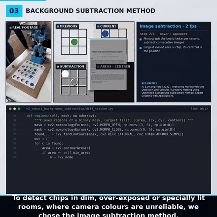</div>

### 8.4 Colour-free tracking by image differencing (`v3_.../diff_tracker.py`)

For rooms where camera colours are unreliable (dim, over-exposed, coloured light) there is a method that **does not detect colours at all**:

* Twice per second the board is photographed and consecutive frames are subtracted (after removing global brightness drift with the median).
* **Chip appears** → region where the new image is darker; **chip vanishes** → region where it is brighter.
* The **largest closed region** and its **centroid** give the position (the 5 mm seat play makes the region noisy, so no circle fit is used).
* The *owner* is never measured: a chip placed right after the robot moved is the robot's, any other new chip is the opponent's, and a chip that is lifted and put down keeps its identity (`placed` / `moved` / `removed` events).

Defaults: threshold 18 grey levels, minimum area 250 px, "same spot" radius 40 px. Tested with a dimming lamp and wobbly synthetic chips (`DiffTracking` test).

### 8.5 Segmentation without a neural network (`segmentation/classical_segmentation.py`)

<table><tr>
<td>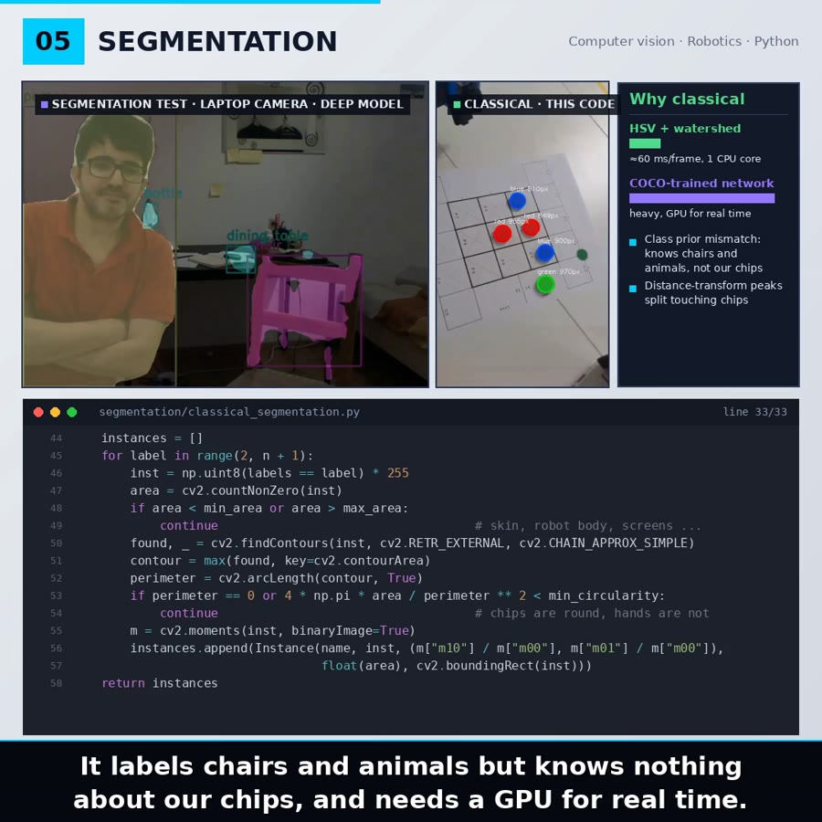</td>
<td>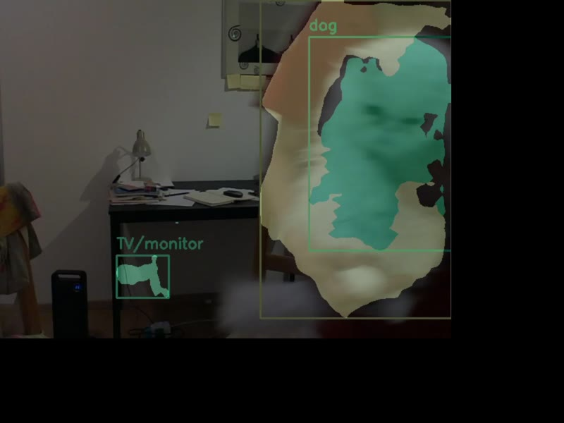<br><sub>A COCO-trained YOLO model on the lab laptop: it knows chairs and animals, not our chips.</sub></td>
</tr></table>

Colour mask → distance transform → seeds at 72 % of the maximum (**one seed per chip, even when chips touch**) → `cv2.watershed` → one mask per chip, filtered by area and (optionally) circularity. Result on our CPU: **≈ 20 ms per 640×480 frame**, no GPU.
`yolo_seg_demo.py` is kept as the benchmark of the heavy alternative (`pip install ultralytics`).

### 8.6 Depth from the chip size (`common/depth.py`)

<table><tr>
<td width="50%">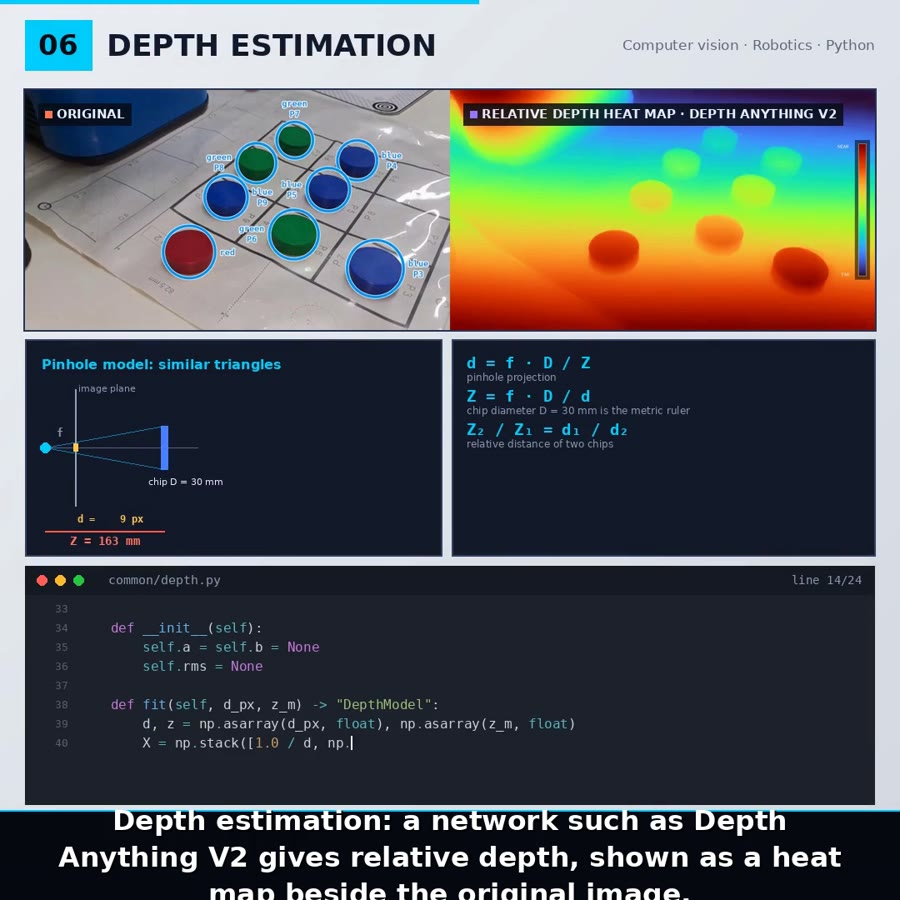</td>
<td><div align="center">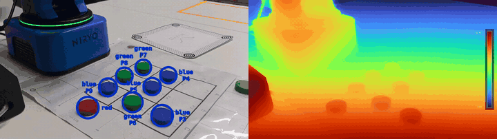</div>
<sub>Relative depth heat map of the board (Depth Anything V2; produced by <code>video_production/depth_heatmap.py</code>) beside the original.</sub></td></tr></table>

A neural network such as Depth Anything V2 gives only *relative* depth. For **metric** distance the chip is the ruler (pinhole model):

```
d_px = f_px · D / Z      →      Z = f_px · D / d_px        (D = 30 mm chip diameter)
Z2 / Z1 = d1 / d2                                           (the smaller chip is farther away)
```

`DepthModel` learns `Z = a/d + b` by least squares from a **few calibration passes** where the true height is measured; afterwards the model replaces the measurement. `SafetyMonitor` keeps the suction cup away from cylinders (chips, board, other arm): clearance = max(lateral − radius − tool radius, height above top), required ≥ 10 mm.

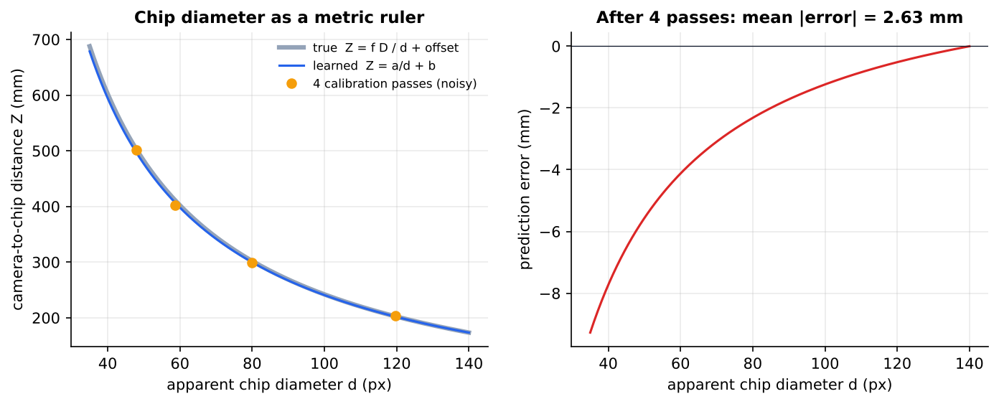

*Simulation with f = 800 px, noisy measurements, 4 calibration passes: mean absolute error 2.6 mm over the working range (d = 35–140 px).*

### 8.7 Motion: arcs in polar space + vertical descent (`common/trajectory.py`, `common/robot_control.py`)

A 6-axis arm is naturally polar: joint 1 = azimuth θ, joints 2–3 = reach r and height z. Interpolating **(r, θ)** instead of (x, y) gives a smooth sweep, and a parabolic z-profile lifts the cup over the chips:

```
r(s) = r0 + (r1 − r0)s      θ(s) = θ0 + sweep·s      z(s) = z0 + (z1 − z0)s + 4·lift·s(1 − s)
```

The **last 30 mm are never part of the arc**: the tool descends *vertically* from a hover point so the cup meets the chip surface perpendicularly and its lip cannot catch a neighbour (`ArmController._descend`; checked by a unit test).

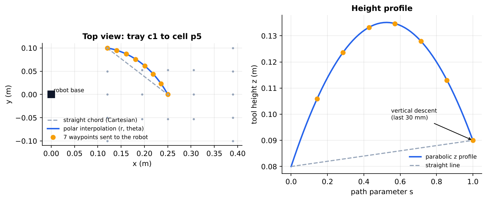

Standby rule for two robots on one board: the robot that is not playing **folds into `REST_JOINTS`** where the other arm cannot hit it, watches only the red-token region, then moves to the fixed **`OBSERVE_POSE`** so every board reading has exactly the same viewpoint.

<table><tr>
<td>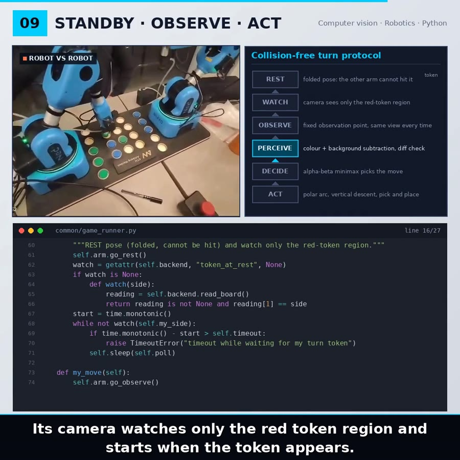</td>
<td>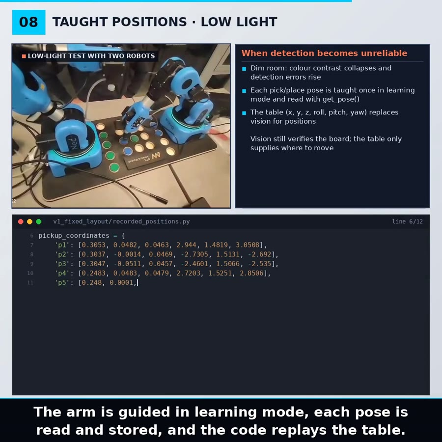</td>
</tr></table>

### 8.8 The game AI (`common/game_logic.py`)

* **MinimaxAgent**: alpha-beta, depth-aware (`10 − depth` for a win → prefers *faster* wins and *slower* losses), ties broken by a preference order (centre, corners, edges). It never loses.
* **RandomAgent**, **HybridAgent** (minimax for the first *n* moves, then random) for demonstrations.
* **`diff_boards(previous, observed)`** compares the board we believe in with what the camera sees. A clean opponent turn gives **exactly one new move and no errors**. A vanished chip, a colour change or two chips at once is *reported instead of played*. This removed the endless "Invalid move" loop that a single bad camera frame used to cause.

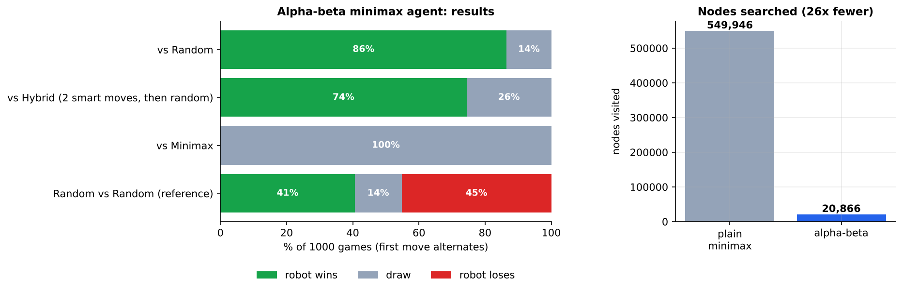

### 8.9 The game loop (`common/game_runner.py`)

`GameRunner` is the only place that knows the game protocol; vision variants plug in through a tiny *backend* interface:

```python
backend.read_board()     # -> (cells[9], token_side)  or None while the view is unstable
backend.cell_xy(i)       # robot XY (m) of cell i
backend.slot_xy("c3")    # robot XY (m) of a chip in tray slot c1..c10
backend.token_xy("A")    # robot XY (m) of the turn-token spot
```

A move is accepted only when the token is on my side **and** exactly one new chip of the opponent's colour appeared. Waiting has a timeout (300 s by default) so a stuck game raises an error instead of hanging forever.

### 8.10 Tests and the simulator (`tests/`)

`tests/synth.py` draws synthetic camera frames of the paper (rotation, shift, brightness, colour cast, shadow, noise, vignetting, wobbly chips) and contains `SimulatedRobotWorld` (grasp removes a chip, release puts it down) and `MockRobot` (records every command).
`tests/test_all.py` has **28 tests**: game rules and agents (minimax never loses), similarity transform, circle detection for any rotation/shift/lighting, all three vision variants, classical segmentation of touching chips, depth and path learning (incl. sudden obstacle), image-difference tracking, and a **complete game** against a simulated human.

---

## 9. Training: what is learned, how, and how to retrain

"Training" in this project is deliberately light-weight — a few least-squares fits that need no GPU, no dataset download and run in seconds. There are **five learned/fitted things**:

| # | What is fitted | Data | Method | File | Command / when |
|---|---|---|---|---|---|
| 1 | **HSV colour ranges** | measured on real chips (H = 2–4, 68, 110, 174) | hand measurement → `HSV_RANGES` | `common/colors.py` | when you change chips/camera |
| 2 | **Pixel→robot map (hand-eye)** | 2 touched points (circle A, B) | closed-form similarity | `calibration.py` | `python main.py calibrate` |
| 3 | **Per-cell correction table** | 9 taught nudges | difference to nominal pose | `tools/record_corrections.py` | `python main.py corrections` |
| 4 | **Depth model** `Z = a/d + b` | ~4 calibration passes | least squares | `common/depth.py` | on the robot, first passes |
| 5 | **Learned path lift** `lift = f(distance, obstacle height)` | 150 simulated practice transfers | trial-and-error search + ridge regression | `common/path_learning.py` | `python main.py train-path` |

### 9.1 The path model in detail (the "machine learning" part)

**Goal:** when the robot carries a chip over an obstacle (other chips, the other arm), how high must the arc be? Too low → collision; too high → long, slow path.

**Step 1 — trial and error (data generation).** For each practice transfer the simulator draws a random start `a` (x ∈ [0.10, 0.14] m), random end `b` (x ∈ [0.20, 0.40] m) and a cylindrical obstacle in the middle (radius 20 mm, top height 70–130 mm). The robot tries **29 lift heights** (0 … 140 mm) on a 3-D parabola

```
path(s) = a + (b − a)·s + 4·s(1 − s)·( lateral·side_vector + lift·z_axis ),    s ∈ [0, 1]
```

and **keeps the shortest collision-free one** (clearance ≥ 10 mm, tool radius 12 mm).

**Step 2 — regression.** Each practice transfer yields one example `(distance, obstacle height) → best lift`. A ridge-regularised polynomial is fitted in closed form:

```
features  φ = [1, dist, height, dist·height, dist², height²]
weights   w = (ΦᵀΦ + λI)⁻¹ Φᵀ y            (λ = 1e-6)
lift̂      = max(0, φ · w)
```

**Step 3 — use.** Every new transfer uses the *prediction* instead of searching 29 candidates. If the predicted arc is blocked (a **new obstacle appeared**), `plan()` searches a **lateral detour**: the arc is bent sideways in the horizontal plane (−100 … +100 mm, 41 steps, with three lift options) and the shortest collision-free candidate wins.

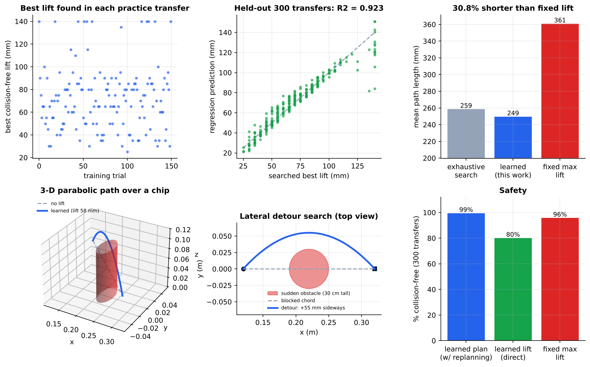

| Metric (300 unseen transfers) | Value |
|---|---|
| Lift prediction R² / mean absolute error | **0.923** / 4.5 mm |
| Collision-free, direct learned prediction | 80.0 % |
| Collision-free after automatic re-planning (final plan) | **99.3 %** (20 % of plans needed re-planning) |
| Collision-free with a fixed maximal lift (no learning) | 95.7 % |
| Mean path length: learned plan / exhaustive search / fixed max lift | **249 mm** / 259 mm / 361 mm |
| Sudden 30 cm obstacle on a 200 mm transfer | detour 55 mm sideways, path 235 mm, collision-free |

*(The learned plan can be slightly shorter than the 5-mm-grid exhaustive search because the regression predicts a continuous lift between grid steps. Numbers are from the simulator, see [limitations](#15-honest-limitations-what-was-tested-and-what-was-not).)*

<div align="center"></div>

### 9.2 Retrain it yourself

```bash
python main.py train-path --trials 150      # a few seconds, prints weights + a check on 300 unseen transfers
# -> saves models/path_model.json
```

```python
from common.path_learning import PathLearner, Obstacle
learner = PathLearner.load("models/path_model.json")
points, info = learner.plan(start_xyz, end_xyz, [Obstacle(x, y, radius=0.02, top=0.10)])
# points: (60, 3) array of x, y, z waypoints;  info: {'lift':..., 'lateral':..., 'replanned': bool}
```

> **Integration note:** the learned-path planner, the depth model and the diff-tracker are fully implemented and tested in simulation, but the shipped game loop (`GameRunner` → `ArmController.travel`) uses the simpler fixed-lift polar arc. To use the learned planner on the robot, feed `points[::8]` of `learner.plan(...)` to `robot.arm.move_pose` in `ArmController.travel` (a good student project, see [section 16](#16-ideas-for-your-own-extensions)).

---

## 10. The challenges and how we solved them one by one

> Format: **Problem → Why it is hard → What we did → Where in the code → Evidence**

### C1 — The robot is not as precise as the board needs
*Gear backlash and low repeatability give millimetre-scale errors, bigger than the clearance of a chip in its hole.*
**Solution (three layers):** (1) travel on a parabolic **arc** in polar space so the cup stays above the chips; (2) the **last 30 mm are a vertical descent** from a hover point so the cup meets the chip perpendicularly; (3) an optional **per-cell correction table** (`corrections.json`) absorbs systematic error; plus chamfered holes and **vision-guided pick** (real chip centroid).
*Code:* `robot_control.py`, `trajectory.py`, `tools/record_corrections.py`.

### C2 — Illumination changes (daylight, lamps, shadows)
*Fixed colour thresholds are not photometrically invariant.*
**Solution:** three escalating levels — HSV + white-patch + CLAHE (v1/v2); **Lab background subtraction with gain matching** (v3); **no colours at all** — image differencing with median drift removal (`diff_tracker.py`).
*Evidence:* synthetic benchmark under dim light, colour casts and shadow ([section 11](#11-results)); lab tests below.

<table><tr>
<td></td>
<td>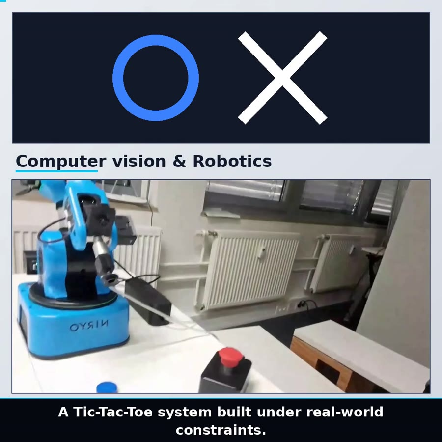</td>
</tr></table>

### C3 — The wrist camera is low grade
*Noisy, compressed, lens-distorted.*
**Solution:** undistort once with the robot's intrinsics (`NiryoCamera`), blur before classification, **majority vote over 5–7 frames** and refuse to answer (`None`) when the view is unstable.

### C4 — Deep detectors are too heavy and know nothing about our chips
*In the lab, YOLO/SAM-style models gave only a few frames per second on laptop CPUs, and COCO-trained models label chairs and dogs.*
**Solution:** classical instance segmentation (HSV + distance transform + watershed): ~20 ms/frame, one mask per chip even when chips touch. The YOLO test is kept as a benchmark (`yolo_seg_demo.py`).

### C5 — The paper is never in the same place
**Solution:** two coloured circles → similarity transform in closed form → the whole layout follows the paper; tracking of the previous circle positions lets the paper be nudged mid-game.

### C6 — Camera pixels must become robot coordinates
**Solution:** the *same two circles* are touched once by the tool tip → `HandEye.fit` (one minute). Tested to recover the true mapping to < 1 µm in simulation (`test_hand_eye_fit_recovers_truth`).

### C7 — Two independent robots must take turns
**Solution:** the **red token protocol** — turn-taking is encoded in the physical world and read by the cameras; no network, no shared state. A robot accepts a move only when the token is on its side **and** exactly one new opponent chip appeared.

### C8 — One bad frame caused endless "Invalid move"
**Solution:** `diff_boards` + stable majority voting; unclear boards are logged and waited out (`unclear board … - waiting`), never played.

### C9 — The arms must not collide
**Solution:** the waiting robot **folds into `REST_JOINTS`** (a pose the other arm cannot reach), watches only the token region, then goes to a **fixed `OBSERVE_POSE`** — identical viewpoint for every reading, which also makes pixel tables valid.

### C10 — It gets dark
**Solution:** taught poses (`recorded_positions.py`): the arm is guided in learning mode, each pose read with `get_pose()` and stored; the code replays the table (`--taught`). Vision only reads the board.

### C11 — No depth sensor, but collisions must be avoided
**Solution:** chip diameter as a metric ruler (`Z = f·D/d`), a learned `Z = a/d + b` after a few measured passes, and a clearance monitor.

### C12 — Obstacles suddenly appear in the path
**Solution:** learned lift + **lateral detour search** ([section 9](#9-training-what-is-learned-how-and-how-to-retrain)).

### C13 — Safe, fast development without the robots
**Solution:** a complete simulator (synthetic camera + mock robot + simulated human), 28 tests, a SolidWorks motion study of the whole cell, and replay of recorded lab videos through `VideoCamera`.

<div align="center">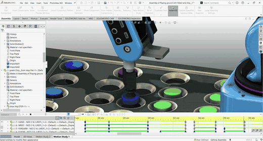</div>

### C14 — A board that fits the problem
**Solution:** custom board designed in SolidWorks, CNC-milled and painted ([section 12](#12-simulation-environment-and-how-the-board-was-built)).

### What makes this approach different from typical robot Tic-Tac-Toe demos?

*(A design comparison with the simplest common approach — fixed coordinates plus a fixed colour threshold — not a literature survey.)*

| Aspect | Simplest common approach | This project |
|---|---|---|
| Board position | hard-coded coordinates | **2 circles** → any rotation/position, tracked live |
| Light | one colour threshold | HSV + white patch + CLAHE, Lab background subtraction, **colour-free** differencing |
| Turn taking | operator presses a key, or a network message | **physical token read by the camera** — works with no link between the robots |
| Wrong reading | wrong move is played | move accepted only if **exactly one** valid change; otherwise wait |
| Robot error | hope for the best | polar arcs, vertical descent, correction table, vision-guided pick |
| Deep nets | heavy GPU model | classical segmentation, ~20 ms/frame on CPU |
| Distance | not used | chip-diameter ruler + learned depth + clearance monitor |
| Paths | fixed hop height | **learned** lift + lateral detour search |
| Testing | on the robot only | full simulator, 28 automatic tests, CAD motion study |

---

## 11. Results

### 11.1 Test suite
`python main.py selftest` → **28 / 28 tests pass** (≈ 20 s, no robot): game rules, agents, trajectory, depth, path learning, calibration, three vision variants, differencing, segmentation, full simulated games.

### 11.2 Game AI (1000 games each, first move alternates)

| Robot (minimax) against | Wins | Draws | Losses |
|---|---|---|---|
| Random player | 865 | 135 | **0** |
| Hybrid (2 smart moves, then random) | 744 | 256 | **0** |
| Minimax | 0 | 1000 | **0** |
| *Reference: random vs random* | *406* | *142* | *452* |

Alpha-beta visits **20,866** nodes from the empty board instead of **549,946** for plain minimax (**26×** fewer); the first move takes ≈ 85 ms.

### 11.3 Vision benchmark (synthetic frames, 20 random boards per condition)

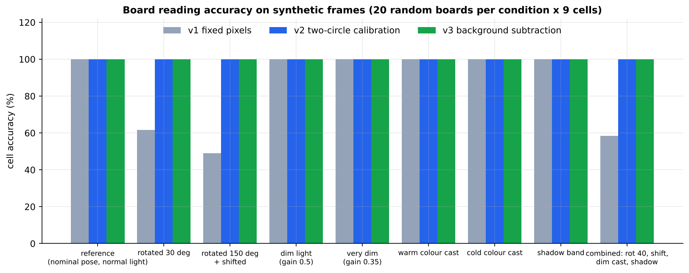

| Condition | v1 fixed pixels | v2 two circles | v3 background subtraction |
|---|---|---|---|
| Nominal pose, normal light | 100 % | 100 % | 100 % |
| Rotated 30° | **61.7 %** | 100 % | 100 % |
| Rotated 150° + shifted | **48.9 %** | 100 % | 100 % |
| Dim light (×0.5, ×0.35) | 100 % | 100 % | 100 % |
| Warm / cold colour cast | 100 % | 100 % | 100 % |
| Shadow band | 100 % | 100 % | 100 % |
| Combined (rot 40°, shift, dim cast, shadow) | **58.3 %** | 100 % | 100 % |

*(Cell accuracy in %; exact-board accuracy is 100 % wherever cell accuracy is 100 %.)* **What this shows honestly:** variant 1 is excellent while nothing moves and collapses as soon as the paper moves — that is exactly why variants 2 and 3 exist. On *synthetic* frames v2 and v3 are tied; the extra robustness of v3 (gain matching, chroma-weighted subtraction) targets real shadows and reflections that a simple synthetic renderer cannot fully reproduce, so judge v3 with your own lab footage.

### 11.4 Speed (median per 640×480 frame, one cloud CPU, no GPU)

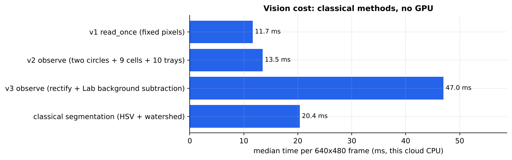

### 11.5 Learned paths and depth
See [section 9.1](#91-the-path-model-in-detail-the-machine-learning-part) (R² 0.92, 99.3 % collision-free, 31 % shorter than a fixed maximal lift) and [section 8.6](#86-depth-from-the-chip-size-commondepthpy) (≈ 2.6 mm mean error after 4 passes, simulation).

### 11.6 On the real robots
Real recordings of robot-vs-human on the paper board and robot-vs-robot on the final board are in the [video library](#13-video-library).

<div align="center">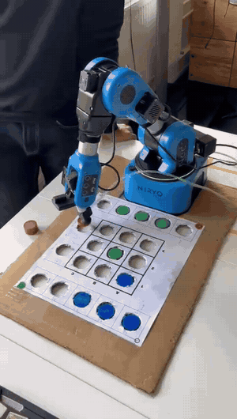 &nbsp; </div>

---

## 12. Simulation environment and how the board was built

**Everything was first validated in a SolidWorks motion study** of both robots and the board; the board was then designed, CNC-milled from wood and painted.

<table>
<tr>
<td>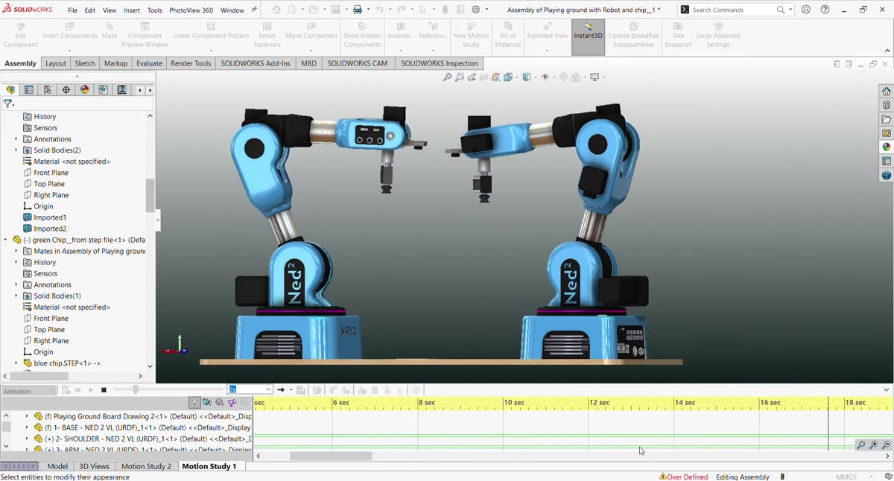<br><sub>SolidWorks motion study: two Ned2 robots and the board.</sub></td>
<td>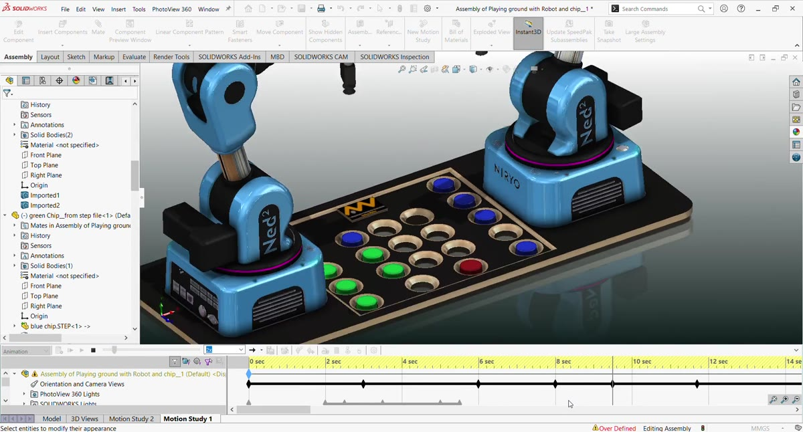<br><sub>Chips and chamfered holes.</sub></td>
</tr>
<tr>
<td>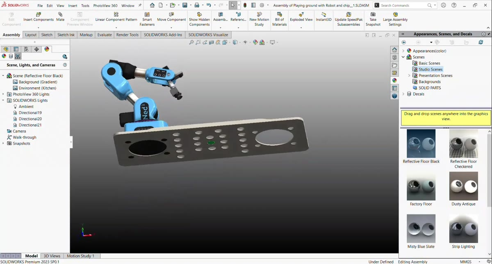<br><sub>Board design in CAD.</sub></td>
<td>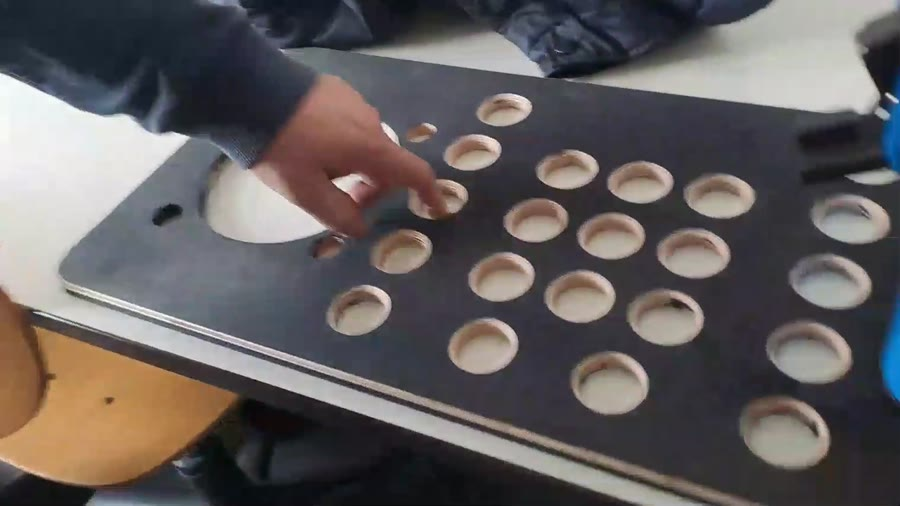<br><sub>The CNC-made board, checked by hand.</sub></td>
</tr>
</table>

Software simulation (no CAD needed): `python main.py demo` — see [section 2](#2-start-here-your-first-10-minutes-no-robot-needed).

**The coding environment** in the lab: Niryo's Jupyter-style notebooks on a laptop while the robot works, then the cleaned-up code in this repository.

<table><tr>
<td>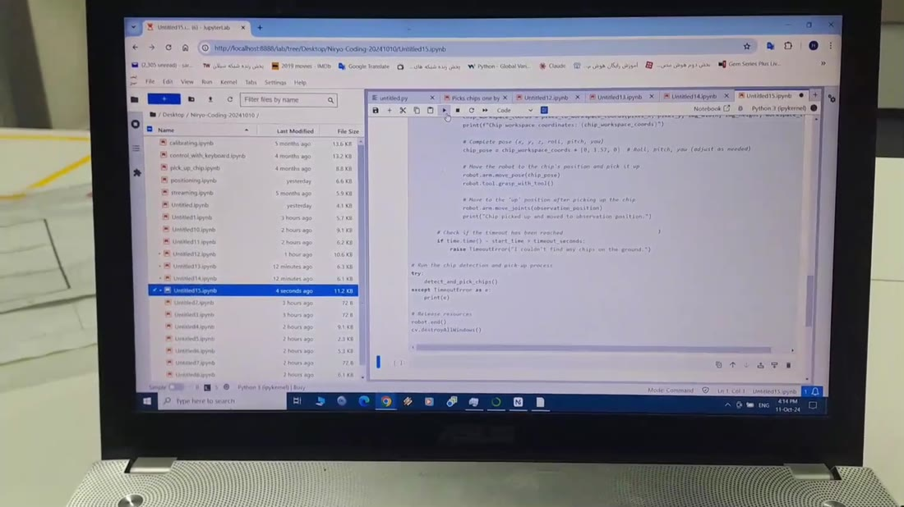</td>
<td>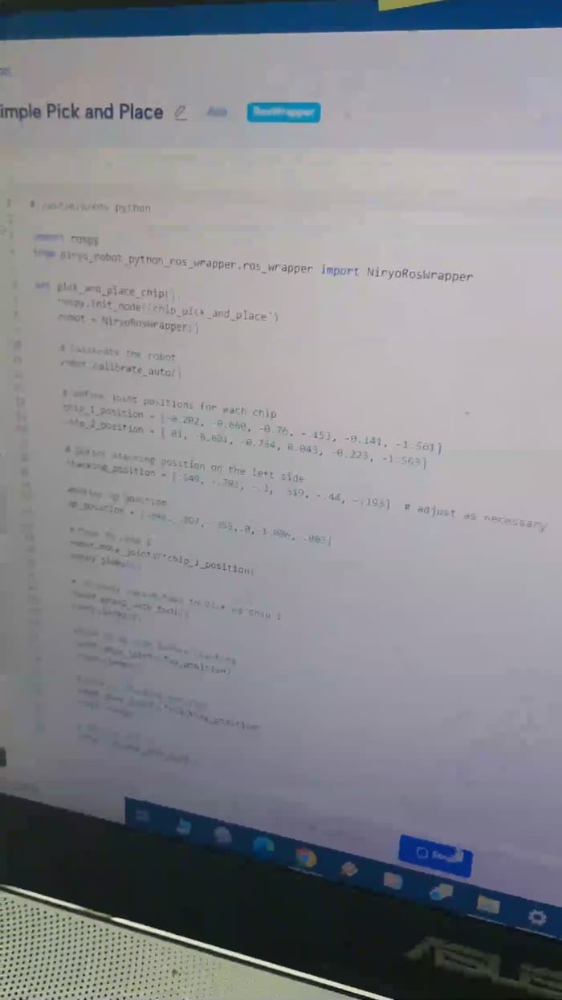</td>
<td>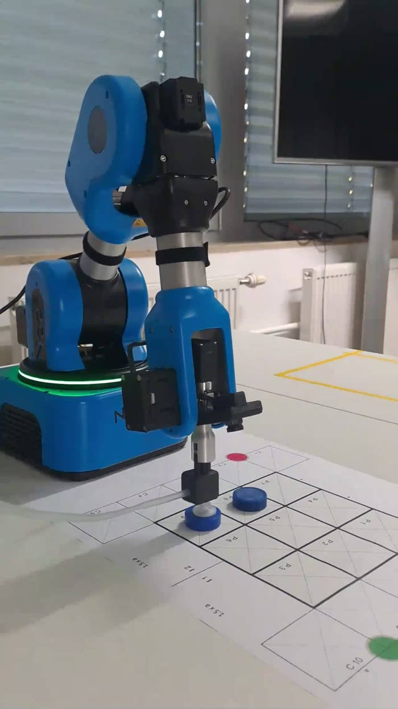</td>
</tr></table>

---

## 13. Video library

The recordings are attached to the **[v1.0.0 release](https://github.com/Hadifard/niryo-ned2-robot-tictactoe/releases/tag/v1.0.0)** (kept out of the repository to keep cloning fast).

| Video | What it shows |
|---|---|
| [**Computer_Vision_Robotics_216s_square_EN.mp4**](https://github.com/Hadifard/niryo-ned2-robot-tictactoe/releases/download/v1.0.0/Final_Movie.mp4) | ★ 4.5-minute explainer film of the whole project (English subtitles: `video_production/subtitles_EN.srt`) |

**Frames from the explainer film** (one per topic):

<table>
<tr>
<td>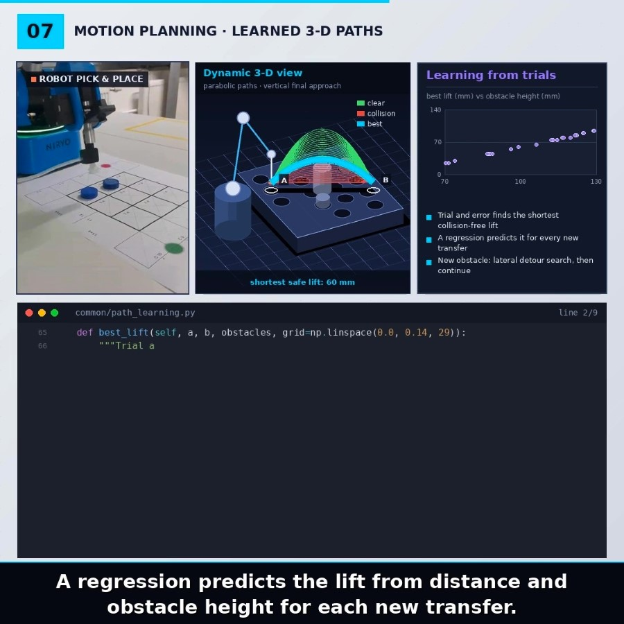<br><sub>Learned 3-D paths</sub></td>
<td>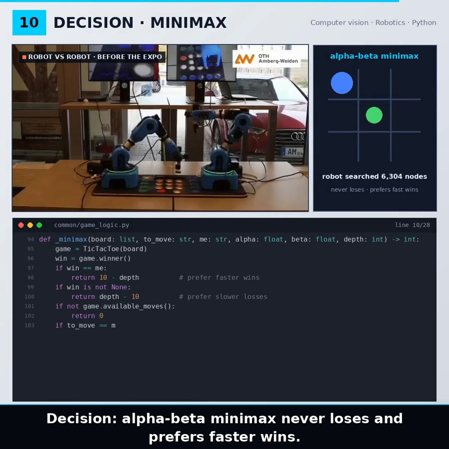<br><sub>Decision: alpha-beta minimax</sub></td>
<td>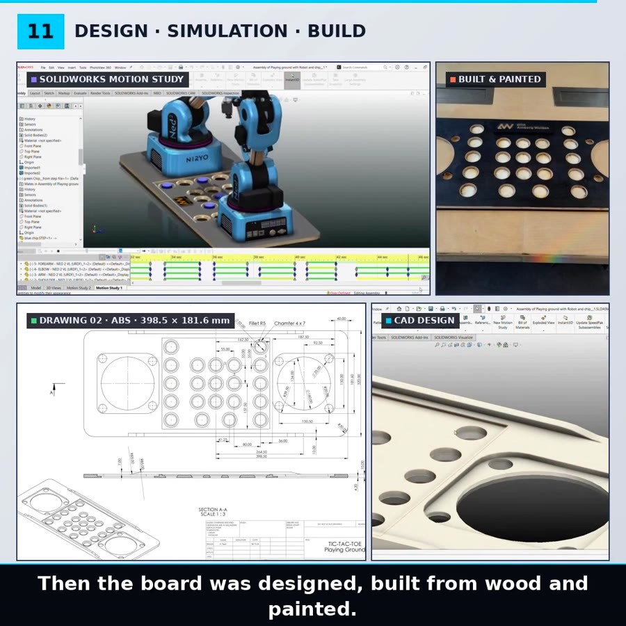<br><sub>Design, simulation, build</sub></td>
</tr>
</table>

`video_production/` contains the Python that rendered this film (scenes, soundtrack synthesis, subtitles) — optional, not needed to run the robots. Its paths are hard-coded to the original machine; edit them if you want to re-render.

---

## 14. Troubleshooting for students

| Symptom | Likely cause → fix |
|---|---|
| `ModuleNotFoundError: No module named 'common'` | You are not in `niryo_tictactoe/`. `cd niryo_tictactoe` and use `python main.py …` or `python -m …` |
| `ModuleNotFoundError: pyniryo2` | Only needed with a real robot: `pip install pyniryo pyniryo2` |
| Cannot connect to the robot | `python main.py check --ip <IP>`; check cable/Wi-Fi, same subnet as the robot (`169.254.200.x` for the default link-local setup), robot is on and calibrated |
| `calibration circles not found (pink=…, green=…)` | The camera does not see both circles: put the paper fully in view at the OBSERVE pose, check lighting, make sure no chip of pink/green colour hides a circle |
| Log keeps printing `unclear board (...) - waiting` | Hand or arm in view, a chip changed colour, or two chips changed at once. Remove the hand; if it persists, check HSV ranges (`common/colors.py`) |
| Colours misread in your room | Re-measure the chip hue (H) under your light and edit `HSV_RANGES`; or use variant 3 |
| Robot misses cells by a few mm | Run `python main.py corrections` and play with `--corrections corrections.json`; check `PICK_Z`/`PLACE_Z` |
| Variant 3 sees chips everywhere / nowhere | It must start with an **empty board**; restart the program with the board cleared |
| Robot 2 never starts | It waits for the red token on **its** side (B). Check the token is carried to spot B and visible in the REST-pose camera view (`REST_TOKEN_PX` in `config_fixed.py`) |
| `TimeoutError: timeout while waiting for …` | Nothing happened for 300 s. Restart; check the token and lighting |
| Windows: OpenCV window does not appear | `pip install opencv-python` (not `-headless`) |

---

## 15. Ideas for your own extensions

1. **Wire in the learned planner:** replace `ArmController.travel` by `PathLearner.plan` waypoints and test with a chip as obstacle.
2. **Use the depth model online:** fit `DepthModel` on the first passes, then use it to set `PICK_Z` automatically.
3. **Use the diff-tracker in the game loop** as a fourth backend (`RobustBackend` alternative) for very dark rooms.
4. **Bigger game:** 4×4 Tic-Tac-Toe or Connect-4 reuse the whole vision stack.
5. **Learn grasp success** from the suction pressure signal, or **anomaly detection** for moved chips and **per-lamp colour models** (ideas from the film's last scenes).
6. **Human-robot play with speech or gestures.**

---

<div align="center">

**Author: Hadi Sarhangi Fard** · [LinkedIn](https://www.linkedin.com/in/hadi-sarhangi-fard-mech-eng/) · [GitHub](https://github.com/Hadifard) · [YouTube](https://youtube.com/@hfard)

*Project work at OTH Amberg-Weiden, 2024. If this repository helps your teaching or research, please star it and cite the project.*

</div>
