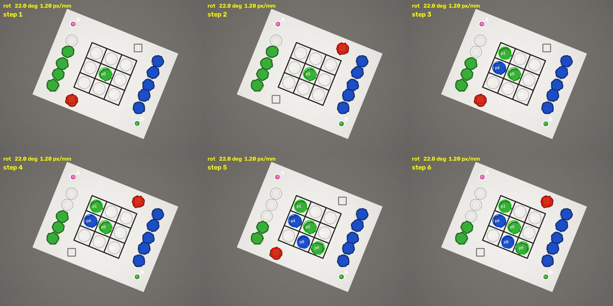

# `niryo_tictactoe/` — the main code folder

**Work from this folder.** Everything is started through one file:

```bash
python main.py guide        # prints all commands
```

Full documentation with figures, diagrams, videos and the explanation of every algorithm is in the
[main README](../README.md). This page is the quick reference.

## First 5 minutes (no robot)

```bash
pip install opencv-python numpy matplotlib pillow
python main.py check        # libraries + self-checks
python main.py selftest     # 28 tests, ~20 s
python main.py demo         # complete simulated game -> demo_output/ (frames + GIF)
python main.py train-path   # trains the learned-path model (seconds) -> models/path_model.json
```



## All commands

| Command | What it does | Needs robot |
|---|---|---|
| `python main.py check [--ip IP]` | checks Python, libraries, (robot network) | optional |
| `python main.py selftest` | 28 automatic tests | no |
| `python main.py demo [--rot DEG] [--seed N]` | full simulated game, saves frames + GIF | no |
| `python main.py train-path [--trials N]` | trains and saves the learned-path model | no |
| `python main.py segment --image f.png` | classical per-chip segmentation of one picture | no |
| `python main.py click-cells [--ip IP]` | variant 1: click 9 cells + 2 token spots → pixel table | camera |
| `python main.py calibrate [--ip IP]` | variants 2/3: hand-eye calibration → `hand_eye.json` | yes |
| `python main.py corrections [--ip IP]` | optional per-cell backlash corrections → `corrections.json` | yes |
| `python main.py play --variant 1\|2\|3 --me green --opp blue --side A --start [--ip IP]` | play | yes |

Robot 2 (second terminal): `python main.py play --variant 2 --ip <IP2> --me blue --opp green --side B` (no `--start`).

## What is in which folder

| Folder / file | Purpose |
|---|---|
| `main.py` | entry point for every task |
| `common/` | game rules + minimax, game loop, robot control, trajectories, colours, cameras, depth, path learning |
| `v1_fixed_layout/` | variant 1: fixed pixels and coordinates |
| `v2_two_circle_calibration/` | variant 2: paper found with two coloured circles |
| `v3_robust_background_subtraction/` | variant 3: light-robust vision, colour-free image differencing |
| `segmentation/` | classical per-chip segmentation and the YOLO comparison |
| `tools/` | one-time helpers: calibration, corrections, path-model training |
| `analysis/` | scripts that generate the figures in the main README |
| `tests/` | 28 tests + synthetic camera / simulated world |
| `TECHNICAL_NOTES.md` | the original concise technical notes of the project |

Every `.py` file begins with: file name, description, author, LinkedIn.
Run commands from this folder, otherwise Python cannot find the packages (`ModuleNotFoundError: common`).

## Troubleshooting in one table

See [section 14 of the main README](../README.md#14-troubleshooting-for-students).

Author: Hadi Sarhangi Fard — https://www.linkedin.com/in/hadi-sarhangi-fard-mech-eng/
